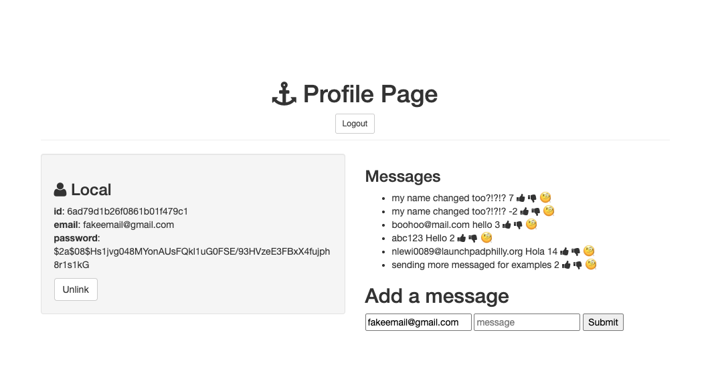

# Savage Auth

A full-stack web application that allows users to create an account, log in, and interact with a message board.Users can post messages, like or dislike posts, and delete messages.

## [Live](https://savage-auth-kxhs.onrender.com/) 

## Photos


## Features
- User signup and login using Passport.js
- Create and delete messages
- Like and dislike messages
- User authentication and sessions
- MongoDB database to store users and messages

## Built With
- JavaScript
- Node.js
- Express.js
- MongoDB / Mongoose
- EJS
- Passport.js
- HTML & CSS

## How to Run

1. Clone the repository.
2. Install dependencies:
   ```bash
   npm install
   ```
3. Set up your MongoDB connection.
4. Start the server:
   ```bash
   npm start
   ```
5. Open `http://localhost:8080` in your browser.

## Credit

Modified from Scotch.io's auth tutorial
